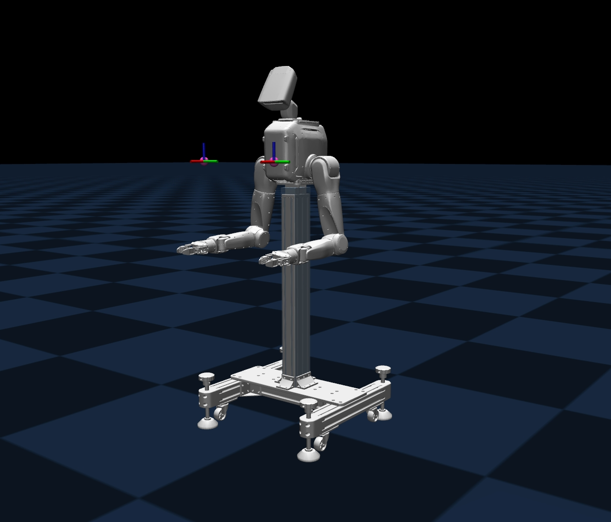

<p align="center">
  
</p>

<p align="center">
  <b>English</b> | <a href="README_CN.md">中文</a>
</p>

<p align="center">
  <a href="LICENSE"></a>
  
  
  
</p>

# DACH_SIM

`DACH_SIM` is a local simulation and SDK validation workspace for the `DACH_TRON2A` dual-arm robot. The MuJoCo simulator, the dual-arm controller, the joystick teleoperator and the WebSocket SDK all run on one machine over `127.0.0.1`, so a motion command can be traced end to end without any hardware.

> **Scope:** loopback simulation only. Both runtime packages ship prebuilt, and the SDK path is validated against `127.0.0.1`; real hardware and on-site networks are out of scope (see [Notes](#notes)). The complete procedure — setup, mode switching, success checks and troubleshooting — is in [`USER_MANUAL.md`](USER_MANUAL.md).

## Quick start

Install the [system dependencies](#system-dependencies) first, and initialise the robot model submodule if `robot_description/` is empty:

```bash
git submodule update --init --recursive
```

Then use four terminals. The start order is not optional: the controller subscribes to what the simulator publishes, and the SDK only answers once the controller is in developer mode.

```bash
# once, in any terminal — without it the controller may not come up with the right model
cd Tron2_controller
source install/local_setup.bash
setRobotSN DACH_TRON2A_001

# terminal 1 — C++ MuJoCo simulator, publishes /motor/state
cd Tron2_simulation_mujoco
./scripts/run_gui.sh

# terminal 2 — controller, subscribes /motor/state and publishes /motor/cmd
cd Tron2_controller
source install/local_setup.bash
install/run_manipulation_sim.sh

# terminal 3 — no physical remote in this setup: publish L1 + X, then R1 + Right
cd joystick_sim
./pub.sh switch

# terminal 4 — SDK smoke test over ws://127.0.0.1:5000
cd Tron2_arm_tests
python3 -m pip install -r requirements.txt
./scripts/run_all.sh
```

`./pub.sh switch` publishes `idle` (`L1 + X`) and then `develop` (`R1 + Right`) with the default 2 s gap. The Move/Servo SDK services are available only after the controller logs its switch into developer mode; until then the SDK reports `developer_mode_required` or `fail_is_not_develop_mode`.

`./scripts/run_all.sh` is the short live smoke. The longer suites are `./scripts/run_move.sh`, `./scripts/run_servo.sh` and `./scripts/run_vla_servoj.sh`; all of them connect to the controller and send motion commands. On a host without a display, use `./scripts/run_headless.sh` instead of `run_gui.sh`; adding `--check-model` only loads the model and checks the 16-axis mapping.

## System dependencies

This repository includes some prebuilt runtime packages. Libraries such as `libmujoco210.so` and `libmroslib.so` are bundled with the repository, but the following runtime libraries are commonly absent from a minimal Linux installation and must come from the system package manager. Package names below use Ubuntu 20.04 / Debian-family distributions as the reference:

```bash
sudo apt update
sudo apt install libglfw3 libglew2.1 libgl1 libwebsockets15 libssl1.1
```

- `Tron2_simulation_mujoco/tron2_mujoco_sim` directly links `libglfw.so.3`, `libGLEW.so.2.1`, and `libGL.so.1`. The same binary is loaded by `run_headless.sh`, so these libraries are still required for headless startup.
- `Tron2_controller/install/bin/signaling_node` directly links `libwebsockets.so.15`.
- `libssl1.1` is not a direct dependency of any binary in this repository. It is a transitive dependency of the `libwebsockets15` package itself (`Depends: libssl1.1`), and is pulled in automatically by `apt` together with `libwebsockets15`.
- Ubuntu 22.04 and newer releases usually do not ship `libssl1.1` in the default repositories. To run the current prebuilt controller directly, use an Ubuntu 20.04-compatible environment, or provide an OpenSSL 1.1 runtime (`libssl.so.1.1` / `libcrypto.so.1.1`) that `libwebsockets.so.15` can load.

## Key interfaces

```text
Tron2_arm_tests -> ws://127.0.0.1:5000 -> Tron2_controller
Tron2_controller -> /motor/cmd -> Tron2_simulation_mujoco
Tron2_simulation_mujoco -> /motor/state -> Tron2_controller
```

`Tron2_simulation_mujoco` only handles low-level motor states and motor commands. SDK interfaces such as MoveJ, MoveP, ServoJ, and ServoP are provided by `Tron2_controller` over WebSocket.

## Project structure

```text
DACH_SIM/
├── USER_MANUAL.md             # Complete user manual
├── robot_description/         # TRON2 robot model submodule
├── Tron2_simulation_mujoco/   # C++ motor-level MuJoCo simulator
├── Tron2_controller/          # TRON2 dual-arm controller runtime package
├── joystick_sim/              # Joystick teleoperator simulator / mode-switch scripts
└── Tron2_arm_tests/           # WebSocket SDK test suite
```

## Documentation

- [`USER_MANUAL.md`](USER_MANUAL.md): robot startup, mode switching, and SDK control workflow.
- [`Tron2_simulation_mujoco/README.md`](Tron2_simulation_mujoco/README.md): C++ simulator environment and startup instructions.
- [`robot_description`](https://github.com/limxdynamics/tron2-robot-description): robot model, URDF/xacro, and mesh documentation. It is a submodule, so its README lives in its own repository.
- [`Tron2_controller/install/README_INSTALL_NEW.md`](Tron2_controller/install/README_INSTALL_NEW.md): instructions for launching the controller runtime package.
- [`joystick_sim/README.md`](joystick_sim/README.md): simulated joystick mode-switch commands, aliases, and runtime arguments.
- [`Tron2_arm_tests/USAGE.md`](Tron2_arm_tests/USAGE.md): SDK test parameters, reports, and dedicated test cases.
- [`NOTICE`](NOTICE): third-party attribution and the MROS / Fast DDS modification notice.
- [`THIRD_PARTY_NOTICES.md`](THIRD_PARTY_NOTICES.md): full license texts of the third-party libraries.

## CI and offline tests

The repository ships the GitHub Actions workflow [`.github/workflows/ci.yml`](.github/workflows/ci.yml). On every push or pull request it installs the Python dependencies required by the SDK tests and runs:

```bash
python3 -m pytest -q
```

This command only runs offline pytest tests that neither connect to the robot nor start the simulator. `Tron2_arm_tests/scripts/run_all.sh` and the dedicated scripts are live simulation bring-up tests: they connect to the local `127.0.0.1:5000` endpoint and send motion commands, so they are not executed as part of the default CI.

## Notes

- The WebSocket control protocol follows the plain `ws://` scheme used by the official `tron2_env`; it has no authentication and no TLS. This open-source workspace only keeps loopback simulation capability, and target addresses should be `127.0.0.1`.
- The live SDK sends motion commands; this open-source workspace does not provide configurations for connecting to real hardware or to on-site internal networks.
- This project does not implement a software emergency stop. Stopping the SDK process, closing the WebSocket, or handling a failed test is not equivalent to an emergency stop; abnormal motions must be handled by the physical emergency stop, the joystick, or robot-side safety mechanisms.
- `Tron2_simulation_mujoco` is a C++ MuJoCo 2.1 runtime package for local simulation; robot XML and meshes come from the top-level `robot_description`.
- `Tron2_controller` is a prebuilt runtime package, not a full source project.

## License

Unless otherwise noted, this project is distributed under the Apache License 2.0 in [`LICENSE`](LICENSE). SPDX identifier: `Apache-2.0`. Attribution for the third-party components included in the prebuilt controller runtime is recorded in [`NOTICE`](NOTICE) and [`THIRD_PARTY_NOTICES.md`](THIRD_PARTY_NOTICES.md).
