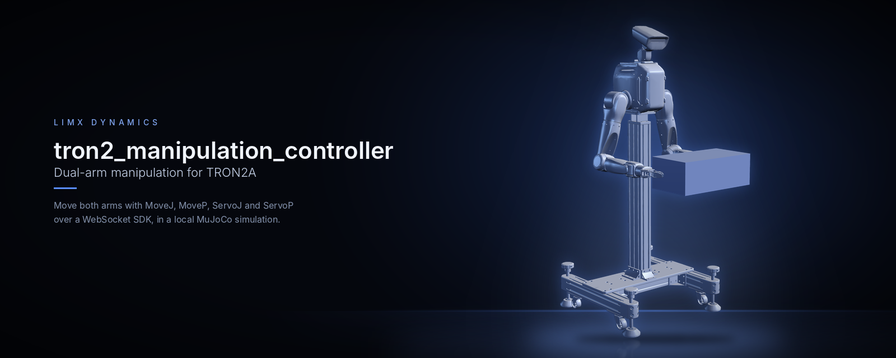
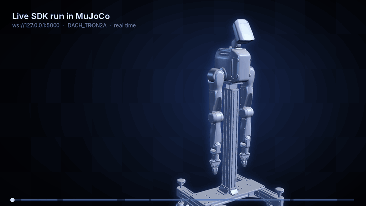
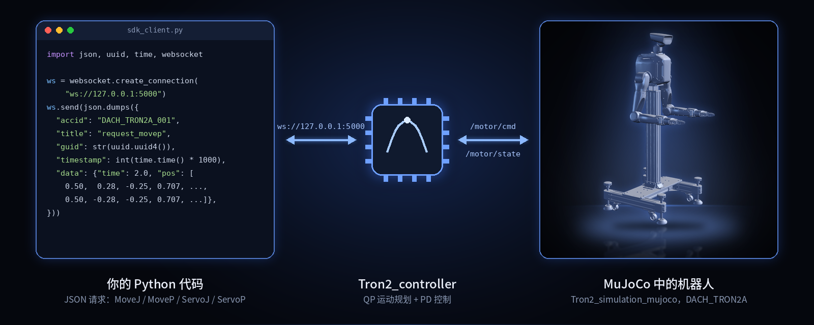

<p align="center">
  
</p>

<p align="center">
  <a href="README.md">English</a> | <b>中文</b>
</p>

<p align="center">
  <a href="LICENSE"></a>
  
  
  
  <a href="https://github.com/limxdynamics/limxdynamics/blob/main/doc/wechat_qr.png"></a>
</p>
<p align="center"><sub>合作采购请联系 <a href="mailto:opensource@limxdynamics.com">opensource@limxdynamics.com</a></sub></p>

# tron2_manipulation_controller

> **TRON2 开源生态的一部分。** 上手路线和其他 TRON2 仓库：[TRON2 快速上手](https://github.com/limxdynamics/limxdynamics/blob/main/doc/quickstart_cn.md#tron2)。

本仓库（工作区名 `DACH_SIM`）是面向 `DACH_TRON2A` 双臂机器人的本地仿真与 SDK 验证工作区。MuJoCo 仿真器、双臂控制器、手柄遥控器和 WebSocket SDK 全部在本机通过 `127.0.0.1` 联调，一条动作指令可以不接任何硬件就走完整条链路。

> **适用范围：** 仅本机回环仿真。两个运行包都是预编译产物，SDK 链路只针对 `127.0.0.1` 验证；真机与现场内网不在范围内（见[注意事项](#注意事项)）。完整流程 —— 环境准备、切模式、成功判据与排错 —— 见 [`USER_MANUAL.md`](USER_MANUAL.md)。

## 演示

<p align="center">
  
</p>

一次实时的搬箱子演示。先用 MoveJ 到准备姿态（未剪入动图），再用 9 个 MoveP 依次接近箱子、下降、夹紧、抬起、平移 10 cm、放下、松开、抬手、收回双臂。10 条指令全部成功，MoveP 末端位置与目标的误差都在 1.7 cm 以内。

机械臂的动作是控制器的真实输出：运行期间通过同一套 WebSocket 接口（`request_get_joint_state`，25 Hz）读回关节角，再在 MuJoCo 中回放。桌子和箱子是渲染时加上的，箱子在"夹紧"到"松开"之间跟随夹爪移动；本仓库的仿真器只模拟手臂和头部的 16 个关节，没有物体，也不模拟夹爪手指。箱子尺寸经过调整，按 0.1 秒间隔逐帧检查，手臂任何部位都不会穿入箱子或桌子。

## 亮点

- **整条链路在一台机器上。** MuJoCo 仿真器、双臂控制器、手柄和 WebSocket SDK 都通过 `127.0.0.1` 通信，不需要真机。
- **五种运动接口。** `MoveJ`、`MoveP`、`MoveH`（头部）、`ServoJ`、`ServoP`，以 JSON 请求经 `ws://127.0.0.1:5000` 下发。
- **QP 运动规划 + PD 控制**，由预编译的 `Tron2_controller` 运行包提供。
- **真实机型。** 带夹爪的 `DACH_TRON2A`，模型来自 [tron2-robot-description](https://github.com/limxdynamics/tron2-robot-description)：双臂各 7 个关节，头部 2 个关节。
- **两层测试。** CI 中跑离线 pytest；对运行中的仿真跑 live 套件（smoke、MoveJ/H/P、ServoJ/P，以及 104.6 秒的 VLA 轨迹回放）。

## 工作原理

<p align="center">
  
</p>

```text
Tron2_arm_tests -> ws://127.0.0.1:5000 -> Tron2_controller
Tron2_controller -> /motor/cmd -> Tron2_simulation_mujoco
Tron2_simulation_mujoco -> /motor/state -> Tron2_controller
```

`Tron2_simulation_mujoco` 只处理底层电机状态和电机指令；MoveJ、MoveP、ServoJ、ServoP 等 SDK 接口由 `Tron2_controller` 通过 WebSocket 提供。

## 快速开始

先安装[系统依赖](#系统依赖)，如果 `robot_description/` 为空，再初始化机器人模型 submodule：

```bash
git submodule update --init --recursive
```

然后使用四个终端。启动顺序不能颠倒：控制器订阅的是仿真器发布的状态，SDK 也要等控制器进入高级开发者模式后才会应答。

```bash
# 一次性，在任意终端执行 —— 不做这一步，控制器可能无法按正确型号启动
cd Tron2_controller
source install/local_setup.bash
setRobotSN DACH_TRON2A_001

# 终端 1 —— C++ MuJoCo 仿真器，发布 /motor/state
cd Tron2_simulation_mujoco
./scripts/run_gui.sh

# 终端 2 —— 控制器，订阅 /motor/state 并发布 /motor/cmd
cd Tron2_controller
source install/local_setup.bash
install/run_manipulation_sim.sh

# 终端 3 —— 本机仿真不含真实遥控器：依次发布 L1 + X 和 R1 + Right
cd joystick_sim
./pub.sh switch

# 终端 4 —— 通过 ws://127.0.0.1:5000 做 SDK live smoke
cd Tron2_arm_tests
python3 -m pip install -r requirements.txt
./scripts/run_all.sh
```

`./pub.sh switch` 按默认 2 秒间隔依次发布 `idle`（`L1 + X`）和 `develop`（`R1 + Right`）。只有在控制器日志出现切模式的记录之后，Move/Servo SDK 服务才可用；在此之前 SDK 会提示 `developer_mode_required` 或 `fail_is_not_develop_mode`。

`./scripts/run_all.sh` 是短时 live smoke，更长的专项套件是 `./scripts/run_move.sh`、`./scripts/run_servo.sh` 和 `./scripts/run_vla_servoj.sh`，它们都会连接控制器并发送动作指令。没有图形界面时用 `./scripts/run_headless.sh` 替代 `run_gui.sh`；加上 `--check-model` 则只加载模型并检查 16 轴映射。

## 系统依赖

本仓库包含部分预编译运行包，`libmujoco210.so`、`libmroslib.so` 等动态库已随仓库提供；但下面这些运行时动态库通常不会在最小 Linux 系统中预装，需要由系统包管理器安装。以 Ubuntu 20.04 / Debian 系发行版为例：

```bash
sudo apt update
sudo apt install libglfw3 libglew2.1 libgl1 libwebsockets15 libssl1.1
```

- `Tron2_simulation_mujoco/tron2_mujoco_sim` 直接链接 `libglfw.so.3`、`libGLEW.so.2.1` 和 `libGL.so.1`。即使使用无窗口脚本 `run_headless.sh`，动态链接器也需要先找到这些库。
- `Tron2_controller/install/bin/signaling_node` 直接链接 `libwebsockets.so.15`。
- `libssl1.1` 不是本仓库中任何二进制的直接依赖，而是 `libwebsockets15` 包自身的传递依赖（其 control 段声明 `Depends: libssl1.1`），安装 `libwebsockets15` 时 apt 会自动带上。
- `libev4` 同样是 `libwebsockets15` 的依赖，apt 会自动安装；若在更新的系统上手动提供 20.04 的运行库，还需要 `libev.so.4`。
- `signaling_node` 用 IPv6 双栈 socket 启动 WebSocket 服务。如果主机或容器在内核层面禁用了 IPv6，控制器日志会出现 `E: ERROR opening socket`，5000 端口没有服务监听；请启用 IPv6（Docker 可加 `--sysctl net.ipv6.conf.all.disable_ipv6=0`）。
- Ubuntu 22.04 及更新版本的默认仓库通常不再提供 `libssl1.1`。如果要直接运行当前预编译控制器，建议使用 Ubuntu 20.04 兼容环境，或提供满足 `libwebsockets.so.15` 加载要求的 OpenSSL 1.1 运行库（`libssl.so.1.1` / `libcrypto.so.1.1`）。

## 项目结构

```text
DACH_SIM/
├── USER_MANUAL.md             # 面向用户的完整使用手册
├── robot_description/         # TRON2 机器人模型 submodule
├── Tron2_simulation_mujoco/   # C++ MuJoCo 电机级仿真器
├── Tron2_controller/          # TRON2 双臂控制器运行包
├── joystick_sim/              # 手柄遥控器模拟器 / 无遥控器切模式脚本
└── Tron2_arm_tests/           # WebSocket SDK 测试套件
```

## 文档入口

- [`USER_MANUAL.md`](USER_MANUAL.md)：用户启动、切模式和 SDK 控制流程。
- [`Tron2_simulation_mujoco/README.md`](Tron2_simulation_mujoco/README.md)：C++ 仿真器环境与启动说明。
- [`robot_description`](https://github.com/limxdynamics/tron2-robot-description)：机器人模型、URDF/xacro 和 mesh 说明。它是 submodule，说明文档在其自身仓库中。
- [`Tron2_controller/install/README_INSTALL_NEW.md`](Tron2_controller/install/README_INSTALL_NEW.md)：控制器运行包启动说明。
- [`joystick_sim/README.md`](joystick_sim/README.md)：模拟手柄切模式命令、别名和运行参数。
- [`Tron2_arm_tests/USAGE.md`](Tron2_arm_tests/USAGE.md)：SDK 测试参数、报告和专项用例说明。
- [`NOTICE`](NOTICE)：第三方库版权归因和 MROS/Fast DDS 修改声明。
- [`THIRD_PARTY_NOTICES.md`](THIRD_PARTY_NOTICES.md)：第三方库完整许可证文本。

## CI 与离线测试

仓库根目录提供 GitHub Actions 工作流 [`.github/workflows/ci.yml`](.github/workflows/ci.yml)，每次 push 或 pull request 会安装 SDK 测试所需的 Python 依赖并执行：

```bash
python3 -m pytest -q
```

该命令只运行不连接机器人、不启动仿真器的离线 pytest。`Tron2_arm_tests/scripts/run_all.sh` 及专项脚本属于 live 仿真联调，会连接本机 `127.0.0.1:5000` 并发送动作指令，不作为默认 CI 步骤执行。

## 验证

2026-11-03 在云端容器中按快速开始运行（Ubuntu 24.04 主机，补充 Ubuntu 20.04 的 `libglew2.1`、`libwebsockets15`、`libev4`、`libssl1.1` 运行库），仿真器使用 `run_headless.sh`：

- 仿真器加载 `robot_grasper.xml`（16 个关节，步长 1 ms），控制器启动并识别 14 个手臂关节，`./pub.sh switch` 后进入开发者模式。
- `./scripts/run_all.sh`：preflight 通过，5 个用例通过 4 个（`H_SAFE`、`J_PREP`、`P_REACHABLE` 误差 14.4 mm、`SJ_TRACK`）。`SP_TRACK`（ServoP，3 秒移动到 20 cm 外的目标）每次都失败，手臂完全不动；把 ServoP 目标换成 MoveP 已能到达的 `P_REACHABLE` 位姿，结果相同。
- `./scripts/run_servo.sh`（在 `run_all.sh` 之后运行）：4 个用例全部通过，包括两个 ServoP。若在刚启动的仿真上直接运行，第一个用例会因手臂尚未处于准备姿态被拒绝，因此请先运行 `run_all.sh`。
- `./scripts/run_move.sh`：在 400 秒时限内完成的 5 个用例全部通过（MoveJ ×2、MoveH ×2、MoveP ×1）。
- 容器内没有 IPv6，`signaling_node` 运行时加了一个仅用于测试的垫片，把它的 IPv6 socket 映射为 IPv4（见[系统依赖](#系统依赖)）。
- 未运行 `run_gui.sh`、`run_vla_servoj.sh`，也未在真机上运行。

## 注意事项

- WebSocket 控制协议沿用官方 `tron2_env` 的明文 `ws://` 方式，不包含认证或 TLS；本开源工作区只保留本机回环仿真能力，目标地址应为 `127.0.0.1`。
- live SDK 会发送动作指令；本开源工作区不提供真机或现场内网连接配置。
- 本项目未实现软件急停。停止 SDK 进程、断开 WebSocket 或测试失败处理都不等同于急停，异常动作应依赖物理急停、遥控器或机器人侧安全机制处置。
- `Tron2_simulation_mujoco` 是 C++ MuJoCo 2.1 本机仿真运行包；机器人 XML 和 mesh 来自顶层 `robot_description`。
- `Tron2_controller` 是预编译运行包，不是完整源码工程。

## 许可证

除另有说明外，本项目基于 [`LICENSE`](LICENSE) 中的 Apache License 2.0 分发，SPDX 标识符为 `Apache-2.0`。预编译控制器运行包中所含第三方组件的版权归因见 [`NOTICE`](NOTICE) 与 [`THIRD_PARTY_NOTICES.md`](THIRD_PARTY_NOTICES.md)。
